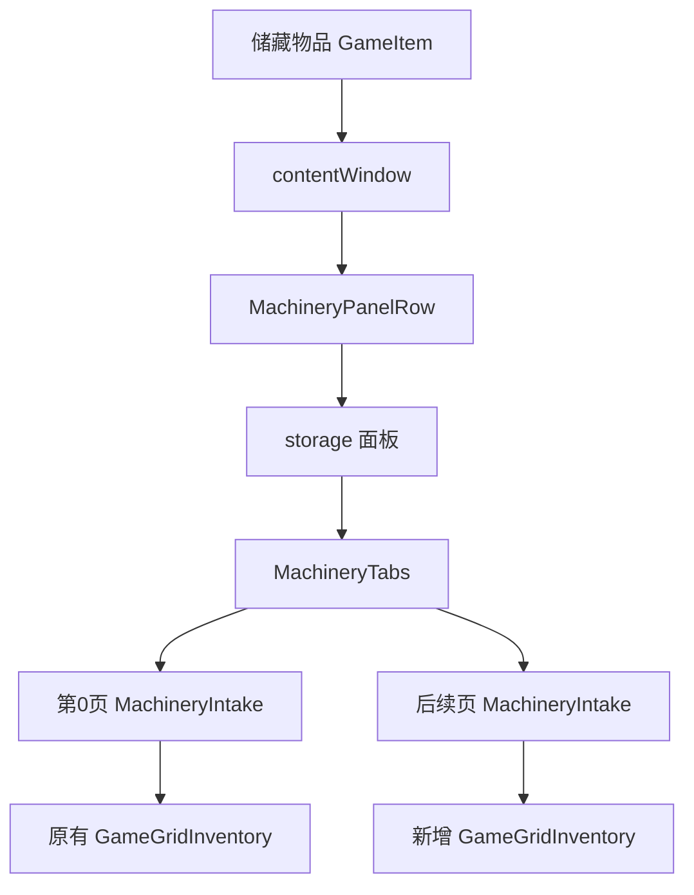

# 升级储藏分页只读调查

日期：2026-10-29。证据为本机正式版 `Probably Stolen_Data/Managed/Assembly-CSharp.dll` 的 Cecil 元数据与 IL；没有启动游戏、修改存档或运行游戏代码。下述实现建议尚未实现，也不等于游戏内验证通过。

## 真实结构

`StorageExpansionHelper.AddTabs(GameItem,int)` 明确操作储藏物品的 `contentWindow`，不是独立店铺库存：

- 升级前 `contentWindow.childElement` 是直接网格。首次升级先 Detach 原网格，再把原网格作为第0页，建立 storage 面板包装；原物品内容无需搬移到另一个网格。
- AddTabs 的 IL_006a 起读取第0页网格的宽高；新增网格同尺寸、调用 SetMachineryStyle，并复制第0页 `mayInventoryAddItemFunc`。因此枪械/化学储藏限制不能被标签匹配绕过。
- `GetKitTabs` 确认 storage_bay、storage_bay_gun、storage_bay_chem 每套增加2页，storage_bay_large 增加1页；Expand 将额外页上限裁为4，即总计最多5页。
- `StorageExpansionHelper.GetTabs` 实际按 contentWindow → MachineryPanelRow → GetPanel("storage") → content as MachineryTabs 获取分页。

## 页面访问与切换

- `MachineryTabs.GetPage(i)` 仅检查索引范围，然后返回 tabs[i].page；不要求 i 等于 selected。
- `CollectStorage` 遍历所有 tabs，并对每个 page 调用 MachineryContainerUtils.Collect，不只采集当前页。
- `Select` 更新 selected 并调用 RefreshTabs；后者对 page.handler.gameObject 调用 SetActive。切页本身不重建或清空各页库存。
- 原生结构允许不切换 UI 就取得隐藏页网格。现有 DirectTransfer 的定位以显式 GridShape 为基础；所检查的 GameGridInventory.TryInventorySlot IL 使用库存形状、物品集合、原生接收条件，没有要求 activeInHierarchy。但转移完整回调链与隐藏页视觉刷新尚需实机验证，不能据此声称已完全支持。

## 保存和身份

- `SaveManager.EncodeNode` 保存物品 name、uniqueId、itemState；遍历存储图，为子物品保存 childItems 和 childItemInventoryNode 配对。
- `DecodeNodesInternal` 先恢复物品属性，再于 IL_013e 调用 StorageExpansionHelper.RestoreTabs，之后才建立存储节点索引并恢复子物品归属。因此各页内容通过重建后的存储图节点索引恢复。
- `RestoreTabs` 读取物品的 STORAGE_EXPANSION_TABS_INT，重建额外页，然后初始化页名。
- 页是网格而非独立 GameItem；不应给页面调用 GameItem.GetUniqueID，也不能用页面标题作为稳定身份。
- 建议 Mod 规则键用“容器 uniqueId + storage 页索引”。首次升级保留原页为0，后续追加页，符合当前版本逻辑。读档必须重新解析网格引用；不持久化对象引用或本次进程中的实例ID。
- `GameItem.GetUniqueID()` 在当前 uniqueId 为0时会分配新ID；仅在用户实际为容器建立规则时按需调用，不在只读扫描时批量调用。
- 标签规则可存 ModHelper.SetModData/GetModData。实际 ModDataStore 访问 PlayerStore.ModData，且仅在已加载存档时可用。仍需验证保存/读档、复制/拆分与销毁清理行为。

## 原生页名已有支持

- `InitTabNames` 注册 onRenameRequest；`OpenRename` 调用 LabelerBlueUIManager.OpenUI，长度上限12。
- `SetTabName` 将换行替换为空格、Trim，再截取最多12个字符；名称列表以换行分隔存于容器的 STORAGE_TAB_NAMES_STRING 标签。全空时禁用该标签。
- `ApplyTabNames` 用各页自定义名或默认名更新 Caption，并 Validate 页面和窗口。
- 页名与收纳规则应分离。不要把收纳属性写入 STORAGE_TAB_NAMES_STRING，也不要把用户收纳标签 EnableTag 到容器本身，避免改变容器的游戏属性。
- 12字符限制是原生接口事实；若用户希望更长，需明确另行设计，不能静默截断其自由命名。

## 与当前实现的集成建议

- `OrganizerWorld.DirectGrid` 当前特意只返回 selected 页，且要求窗口可见。保留这个现有快捷转移含义，新增独立的分页枚举入口，避免顺便改变旧功能。
- 新入口返回 owner GameItem、pageIndex、实际 GameGridInventory；普通单网格容器使用页0。升级储藏只从已确认的 storage 分支枚举，不能递归把内部小箱子或机器其他接口混为同一目标。
- 用户选择“当前页”时每次触发重新读 selected；选择全部页时遍历 count/GetPage 并解包 MachineryIntake.content。每次转移前重新确认规则目标仍存在、所有权、容器锁、原生插入规则和自包含检查。
- 规则可以独立绑定每页，技术上无需给页创建物品；是否支持容器总规则、页面覆盖规则、当前窗口的隐藏页是否算“打开范围”，均是产品决定，不能从现有代码推定。
- 复用 DirectTransfer.Move 的固定物品保护、MayRemove、MaxNumRemove、IsInsertLocked、MayPlayerInsertInto、MayHaveValidInventorySlot、自包含保护、直接层堆叠和旋转翻转定位。跨页/跨容器顺序、满后继续尝试及部分转移通知需另行确定。
- 不自动调用 Select 来逐页收纳；遍历真实网格即可，避免改变用户正在查看的页。

## 必须补充的验证

1. 普通储藏、枪械储藏、化学储藏、大型储藏，首次及再次升级后每页规则和物品内容一致。
2. 第0页既有规则升级后的迁移；命名后修改名字不改变标签绑定。
3. 窗口关闭、窗口打开但目标页隐藏、切换当前页时，收纳结果与设定范围一致，UI刷新正确。
4. 保存读档后各页物品和规则仍对应；移动整个容器后规则保留；销毁或出售容器后不误匹配其他容器。
5. 目标空间不足、部分堆叠、原生类别限制、锁定、固定、容器套容器及循环防护。
6. 多个匹配目标与多选物品时顺序稳定；旧的明确目标快捷转移行为不变。
